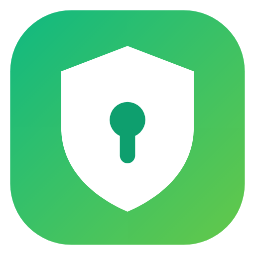
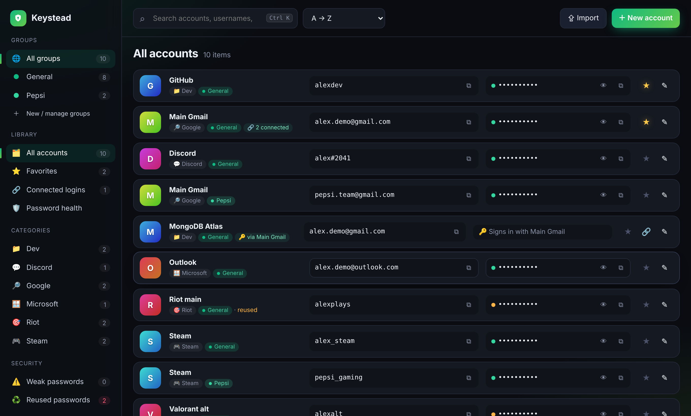
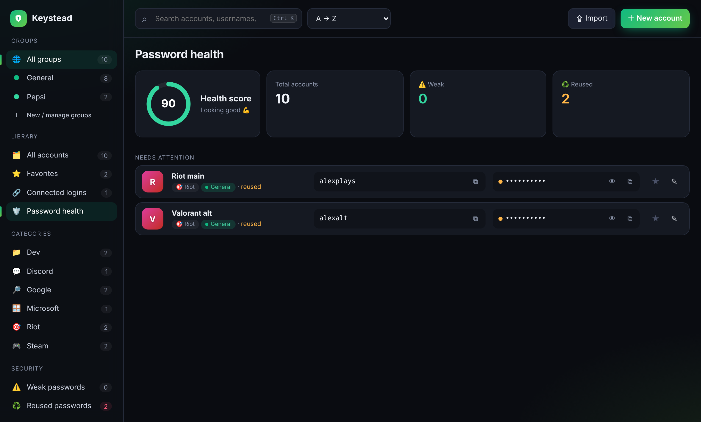
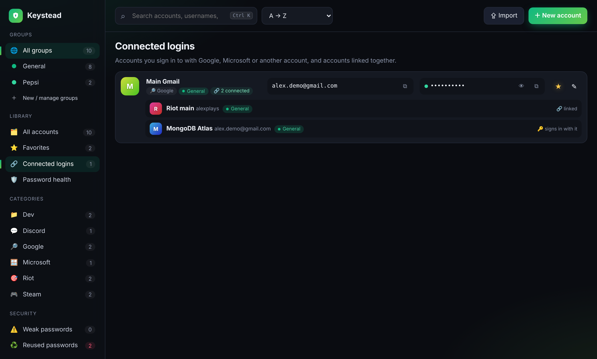
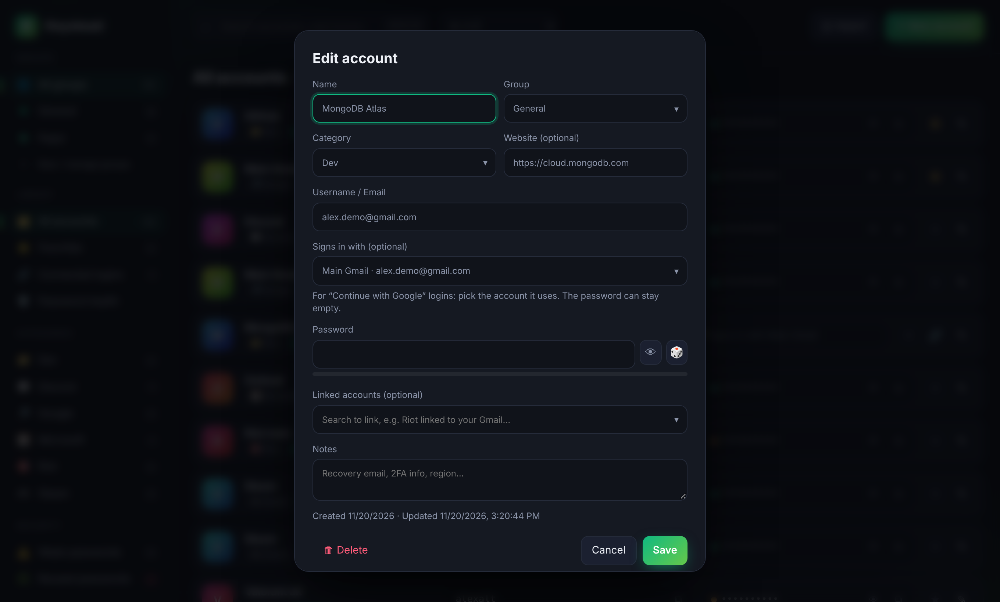
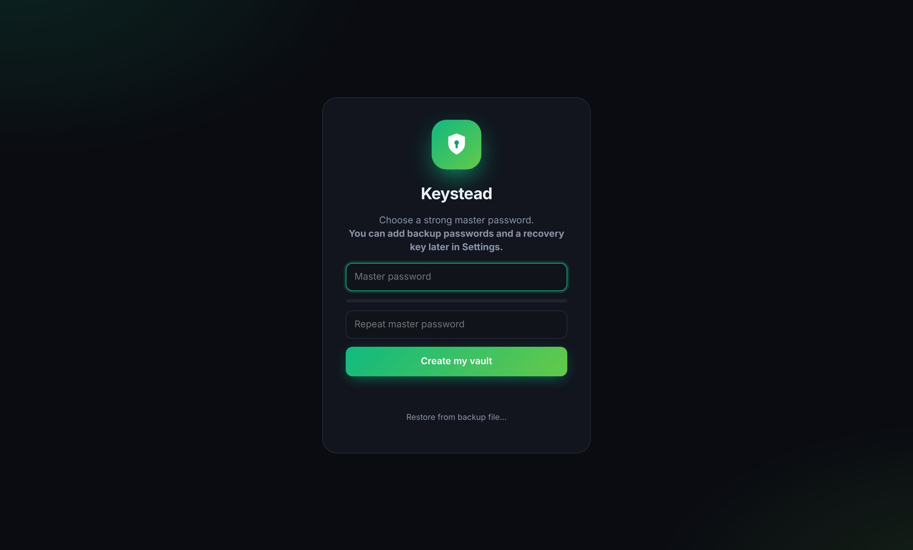
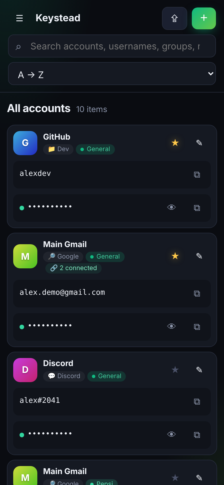

<p align="center">
  
</p>

<h1 align="center">Keystead</h1>

<p align="center">
  A private, offline password manager for Windows and Android.<br>
  No cloud, no account. Your devices sync directly over your own Wi-Fi.
</p>

<p align="center">
  
  
  
</p>

<p align="center">
  
</p>

## Download

Grab the latest **Keystead.exe** (Windows 10/11) or **Keystead.apk** (Android 8+) from the [Releases](../../releases) page.

> Windows may show *"Windows protected your PC"* because the app isn't code-signed. Click **More info → Run anyway**. On Android, allow installing from your browser or file manager when asked.

## Features

**Security**
- AES-256-GCM encryption with Argon2id key hardening
- Several unlock passwords plus a printable recovery key, so forgetting one doesn't lock you out
- Vault file locked to your Windows account; fingerprint unlock on Android
- Auto-lock, auto-clearing clipboard, and hidden from Discord/OBS screen sharing (with an optional, clearly marked "show on stream" mode)

**Organising**
- **Groups** for different people or projects, each with a colour label. The same account name can exist in several groups.
- Categories, favourites, search, filters and sorting

**Connected logins**
- Mark accounts that sign in *with Google or Microsoft* (e.g. MongoDB via Gmail)
- Link related accounts, and see everything that depends on each Google/Microsoft account on one page

**Importing**
- One-click import from Chrome, Edge, Opera GX, Brave and Firefox
- Reads messy `.txt` notes and Bitwarden JSON; skips duplicates by username or email

**Autofill**
- **Browsers:** the Keystead extension for Chrome, Edge, Opera GX and Brave fills logins on the exact website they're saved for
- **Windows apps:** press <kbd>Ctrl</kbd>+<kbd>Alt</kbd>+<kbd>A</kbd> in any login box (Riot, Steam, Discord…), pick the account, and Keystead types it in
- **Android:** works as the phone's autofill service, unlocked with your fingerprint

**Password health**
- Health score, weak and reused password warnings, and a strong password generator

**Sync**
- Tap-to-pair with nearby devices, confirmed by a matching 6-digit code
- PC ↔ laptop ↔ phone sync over your Wi-Fi, encrypted end to end; encrypted backups you can restore anywhere

## Screenshots

| Password health | Connected logins |
|---|---|
|  |  |

| Edit an account | Lock screen | Android |
|---|---|---|
|  |  |  |

## How the encryption works

Your vault is encrypted with a random 256-bit key. Each of your unlock passwords is stretched with **Argon2id** and used to wrap that key, so any one of them opens the vault. The data itself is sealed with **AES-256-GCM**, which also detects tampering. On Windows the file on disk is additionally protected with **DPAPI**, tying it to your account. Sync pairing uses an **ECDH** key exchange, so the shared key never travels over the network.

See [SECURITY.md](SECURITY.md) for the full details.

## Build it yourself

### Windows
Requires Python 3.10+.
```bat
cd desktop
build.bat
```
The app is created at `desktop\dist\Keystead.exe`.

### Browser extension
See [extension/README.md](extension/README.md): load the `extension` folder as an unpacked extension, then connect it to the app with the 6-digit code it shows.

### Android
1. Install [Android Studio](https://developer.android.com/studio).
2. **File → Open** the `android` folder and let Gradle sync.
3. **Build → Build APK(s)**. The APK is at `android/app/build/outputs/apk/debug/`.

Always build updates with the same signing key, or Android won't install them over the old version.

## Project structure

```
desktop/   Windows app: UI (MyVault.html), launcher, Wi-Fi sync server, build script
android/   Android Studio project (WebView app with fingerprint unlock and sync)
extension/ Browser extension (Chrome, Edge, Opera GX, Brave)
docs/      Logo and screenshots
```

The interface is one HTML file shared by both apps. The desktop launcher (pywebview) and the Android app (WebView) wrap it and add native features: file storage, clipboard, sync networking, fingerprint unlock and screen-capture protection.

## Disclaimer

Keystead is a personal project and hasn't been independently audited. Keep an encrypted backup of your vault.

## License

[MIT](LICENSE). Third-party components are listed in [THIRD_PARTY_NOTICES.md](THIRD_PARTY_NOTICES.md).
